# Sector trend explanations

Why the emission factor trend looks the way it does, for each sector we assess.
Status and links are in the tracker,
[`B_driver_investigation.md`](B_driver_investigation.md). How to assess a sector
is in [`About_sector_deep_dive.md`](About_sector_deep_dive.md).

Each sector has the same fields:

| Field | What goes here |
|---|---|
| **B** | The trend in the direct emission factor, 2017 to 2024, with 2017 = 1, and the 2017 value in kg CO2e per constant 2017 dollar |
| **E** | The trend in sector emissions, 2017 to 2024, with 2017 = 1, and the 2017 value in Mt CO2e |
| **E source** | The inventory tables and attribution routes behind `E`, largest first, with their share over the span |
| **E explanation** | Why `E` moved, or didn't |
| **q** | The trend in commodity output, 2017 to 2024, with 2017 = 1, and the 2017 value in billions of constant 2017 dollars |
| **q explanation** | Why `q` moved, or didn't |
| **A explanation** | Which purchases in `A` changed, and why. The triage lists the largest, as gross percent of `N_d` over the span |
| **L explanation** | How much `L` moves this sector's `N_d`, and why |
| **Conclusion** | Identify the culprit and tie together the relevant explanations. Mark it provisional until the explanations above are written. |

Sectors come from the tracker's list, which also says which model the figures come from and holds the issues and PRs. Curves share one scale, with a dashed line at 1, dotted lines at 0.5 and 2, and the 2024 value at the end.

Keep each explanation short and simple. Describe trends in plain words, and don't refer to commits, versions or PRs. Production indexes are Federal Reserve G.17, and price checks are BLS producer price indexes, both annual averages from FRED.

**Earlier findings** are leads from an older run of the model, so they may not match the figures above. Older notes that cite "tracker row N" refer to these.

## Sectors

### 221100 Electric power generation, transmission, and distribution

| Field | Value |
|---|---|
| **B** | 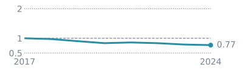 2017 = 3.9 |
| **E** | 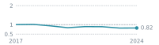 2017 = 1791 |
| **E source** | `eGRID` via `Direct` (99%) |
| **E explanation** | `E` falls 18%, mostly because power plants burn less coal. Coal burned falls 44%, gas burned rises 47%, and wind and solar double from 8% to 16% of generation. EIA's separate count of power-sector CO2 also falls 18%. The largest drops are in 2019, 2020 and 2023, the years coal fell most. The one clear rise is 2021 (+7%), when coal came back as gas prices rose. |
| **q** | 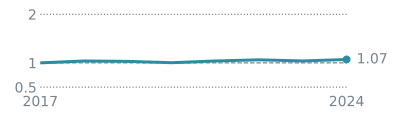 2017 = 455 |
| **q explanation** | The trend is right, but the level looks too high. `q` rises 5%, close to the 6% rise in kWh sold. In 2024 it is $590bn against $514bn of EIA retail revenue. Household bills match EIA. The extra is on commercial bills ($38bn), industrial bills ($19bn) and electric power's own purchases ($12bn). A separate survey of buildings, CBECS, points the same way: in 2018 buildings report $119bn of electricity, against $178bn in the model for commercial buyers that are mostly buildings. The cause isn't confirmed. |
| **A explanation** | Small. Own use moves most: 2.37 per $100 of output in 2020, 3.07 in 2021 and 2.05 in 2024, and nothing explains the 2021 step yet. Upstream emissions are only 4-5% of `N_d`, and their trend isn't fully supported, but holding them constant would only end `N_d` at 0.78 of 2017 rather than 0.77. |
| **L explanation** | Little: 13% of the movement in `N_d`, because the sector's own direct emissions are 95% of its factor. |
| **Conclusion** | **Trend justified, level open.** `N_d` falls 23%, and EIA's CO2 per kWh also falls 23%, with each year's change within 0.8 points. Less coal explains it, so the trend should not be smoothed. In each year's own dollars the factor falls 38%, because retail prices rise 24%. The open problem is the level: `q` looks too high, so the factor per dollar looks too low. Moving `q` to EIA's level would raise `B` 15-17% in every year and barely change the trend. |

### 481000 Air transportation

| Field | Value |
|---|---|
| **B** | 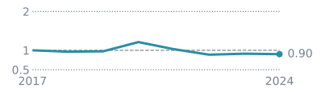 2017 = 0.7 |
| **E** | 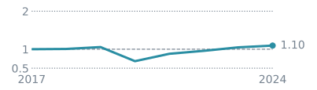 2017 = 163 |
| **E source** | `UMD_GHGIA_T_3_8.direct_jet` via `Direct` (99%); `UMD_GHGIA_T_3_10.direct_non_road` via `Direct` (1%) |
| **E explanation** | Almost all of `E` is jet fuel. It falls about 35% in 2020, when fewer planes flew during COVID, and recovers about 28% in 2021. |
| **q** | 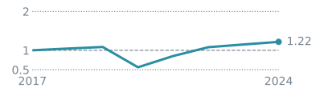 2017 = 232 |
| **q explanation** | `q` falls about 48% in 2020 and rebounds about 51% in 2021, more than fuel does, because passenger travel collapsed further than fuel use. So `B` spikes and then unwinds. |
| **A explanation** | Largest cells, gross percent of `N_d`: Petroleum refineries bought by Air transportation (10.9); Oil and gas extraction bought by Petroleum refineries (1.6); Scenic and sightseeing transportation and support activities bought by Air transportation (1.4). The 2020 and 2021 moves come from `E` and `q`, not from purchases. |
| **L explanation** | Secondary in 2020 and 2021, and doesn't explain the move in `N`. |
| **Conclusion** | **Justified.** The 2020 rise in `B` (+22%) and its unwind in 2021 are COVID, so they should not be smoothed. By 2024 `B` is 10% below 2017, with `E` up 10% and `q` up 22%. About two thirds of that fall is less fuel per passenger-mile (down 7%). Planes aren't fuller, at about 83.5% of seats in both years, so this is more efficient flying. The other third is output per passenger-mile rising 4%. That isn't higher profit, because operating margins fall from 12.2% to 5.5%. Still open: whether the 4% is more service per passenger-mile or a price index that lags fares. |

### 211000 Oil and gas extraction

| Field | Value |
|---|---|
| **B** | 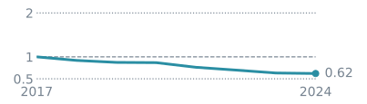 2017 = 1.5 |
| **E** | 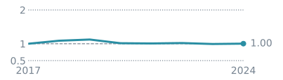 2017 = 353 |
| **E source** | `UMD_GHGIA_T_3_28` via `Direct` (32%); `UMD_GHGIA_T_3_11.natural_gas_lease_plant` via `GHGRP_NEI_Facilities` (26%); `UMD_GHGIA_T_3_25` via `Direct` (13%) |
| **E explanation** | Not yet assessed. |
| **q** | 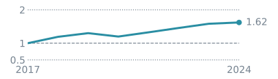 2017 = 213 |
| **q explanation** | Not yet assessed. |
| **A explanation** | Not yet assessed. Largest cells, gross percent of `N_d`: Oil and gas extraction bought by Oil and gas extraction (11.7); Electric power generation, transmission, and distribution bought by Oil and gas extraction (6.3); Pipeline transportation bought by Oil and gas extraction (5.9) |
| **L explanation** | Not yet assessed. |
| **Conclusion** | **Provisional.** `B` falls 38% because `q` rises 63% while `E` stays flat. Flat `E` hides falling emissions in two inventory lines (122 to 108 Mt and 63 to 38 Mt) and rising lease and plant fuel (80 to 105 Mt). First check `q` against production volumes, because its price index swings from 0.70 to 1.81 of 2017. `L` is 48% of the movement. Own use is the largest `A` cell and swings widely: 2.57 per $100 of output in 2020, 6.97 in 2022 and 2.82 in 2023. Check whether 2021-22 is overstated. |

Earlier findings:

**Earlier tracker row 1**

- **Driver:** Oil and gas extraction `211000` industrial fuel — **both cells run on the Use table**
- **Issue:** [#923](https://github.com/cornerstone-data/bedrock/issues/923) · cause [#933](https://github.com/cornerstone-data/bedrock/issues/933)
- **Diagnostic:** D9 · D8
- **Effect:** Two cells move 115 Mt across the span and arrive 6 Mt from where they started. The largest pair of rocky cells in the panel, and the contrast with this sector's own `Direct` cells — 79.0 and 62.9 Mt gross at oscillation 0.11 and 0.17 — is the cleanest statement in the panel of what attribution churn costs. The cell labelled MECS is not a MECS vector: `petroleum_industrial` is BEA Use purchases of `324110` rescaled by a MECS fuel share that is constant within a survey vintage, so both cells move with the Use table and that is why they move together.
- **Potency:** 64.0 + 51.3 Mt gross; oscillation 0.98 and 0.87
- **Justified?:** **not justified** — three external checks agree: GHGRP subpart C for these facilities holds a 1.08x span while ours spans 3.05x, the allocation drops **below** that measured floor in 2017 and 2020, and the driving coefficient moves at the 98th percentile of its own Use row
- **Status:** **Reassess after [#929](https://github.com/cornerstone-data/bedrock/issues/929) lands.** The facility basis replaces this vector outright — `211000` is in scope. ⚠️ The claim that the facility evidence marks it **down 2.6pp** of share is **withdrawn**: on the published build `share_shift_pp` is **+1.81pp**, so the basis would give the sector more share, not less. The three checks in this row stand — they compare against subpart C, which is combustion only, while the share shift compares against the full facility union including process units. ⚠️ #918 was never the lever and is being retired; the cause is row 12 ([#933](https://github.com/cornerstone-data/bedrock/issues/933)) and the fix is [#923](https://github.com/cornerstone-data/bedrock/issues/923)

**Earlier tracker row 16**

- **Driver:** Oil and gas extraction's petroleum input coefficient
- **Issue:** [#922](https://github.com/cornerstone-data/bedrock/issues/922)
- **Diagnostic:** D9 · D8 · D14
- **Effect:** The mechanism under row 1. `211`'s purchases of refined petroleum per $100 of its own gross output go 0.85 → 2.64 → 1.69 over the span — **3.11x to 2022, then −29%** — against a median buyer move of 0.91x and a 90th percentile of 1.53x on the same row. The largest single jump, +71%, is 2017→2018, the first year off the published benchmark. Both sides are nominal and every buyer purchases the same commodity, so a petroleum price move cannot produce it.
- **Potency:** 98th percentile of coefficient movement; drives the 51.3 Mt cell in row 1
- **Justified?:** **not justified** — the complete facility floor for these facilities, GHGRP subpart C **plus the subpart W combustion tables** ([#927](https://github.com/cornerstone-data/bedrock/issues/927), PR #961), holds 113.3-140.2 Mt across 2017-2024 against an allocation of 29.6-90.1 Mt. The sector is allocated **26-67% of the fuel its own facilities reported burning, in every year of the span**
- **Status:** ⚠️ **Restated on the complete floor.** Read against subpart C alone this was the worst *intermittent* sector, breaching in 2017 and 2020 only; subpart C holds no lease fuel at all, because onshore production reports its combustion under subpart W. On the whole floor it breaches in **all eight years**, with the largest cumulative shortfall in D14 — 589 Mt against 321 Mt for petroleum refineries — and its verdict reads `boundary_offset`, which here means a persistent level defect and not a definition difference. The two defects now separate cleanly: the **level** bias is measured and attributed (#927), the **volatility** is still open. `32551` moves 17.69x on the coefficient and likely shares a cause

### 484000 Truck transportation

| Field | Value |
|---|---|
| **B** | 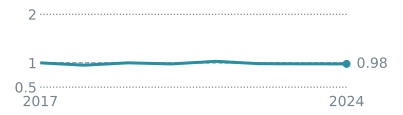 2017 = 0.47 |
| **E** | 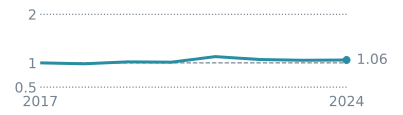 2017 = 170 |
| **E source** | `UMD_GHGIA_T_3_8.petroleum_fuels_diesel` via `Energy_highway_fuel_shares_national` (90%); `UMD_GHGIA_T_3_8.petroleum_fuels_gasoline_trucks` via `Energy_highway_fuel_shares_national` (5%); `UMD_GHGIA_T_A5_5_2` via `Direct` (4%) |
| **E explanation** | Not yet assessed. |
| **q** | 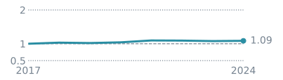 2017 = 341 |
| **q explanation** | Not yet assessed. |
| **A explanation** | Not yet assessed. Largest cells, gross percent of `N_d`: Petroleum refineries bought by Truck transportation (7.1); Electric power generation, transmission, and distribution bought by Truck transportation (7.0); Truck transportation bought by Truck transportation (4.2) |
| **L explanation** | Not yet assessed. |
| **Conclusion** | **Provisional.** There's no trend to explain: `B` stays within 5% of 2017 every year and ends 3% lower, with `E` up 5% and `q` up 8%. The largest move is 2021, when diesel emissions rise 11%. Check own use, which steps from 4.21 to 6.72 per $100 of output in 2023 and stays there. `L` is 40% of the movement. |

### 324110 Petroleum refineries

| Field | Value |
|---|---|
| **B** | 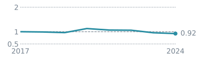 2017 = 0.47 |
| **E** | 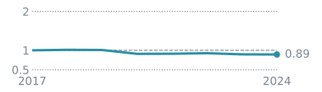 2017 = 197 |
| **E source** | `UMD_GHGIA_T_3_11.petroleum_still_gas` via `GHGRP_NEI_Facilities` (51%); `UMD_GHGIA_T_3_11.ng_manufacturing` via `Hybrid_Facility_MECS` (26%); `UMD_GHGIA_T_3_11.petroleum_facility` via `Hybrid_Facility_MECS` (9%) |
| **E explanation** | Not yet assessed. |
| **q** | 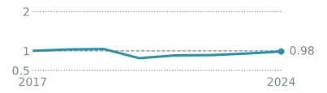 2017 = 477 |
| **q explanation** | Not yet assessed. |
| **A explanation** | Not yet assessed. Largest cells, gross percent of `N_d`: Oil and gas extraction bought by Petroleum refineries (13.8); Electric power generation, transmission, and distribution bought by Petroleum refineries (9.2); Pipeline transportation bought by Petroleum refineries (5.3) |
| **L explanation** | Not yet assessed. |
| **Conclusion** | **Provisional.** `B` ends 8% lower. It rises 17% in 2020, when `q` falls 22% and `E` falls 10%, the same COVID pattern as air, so this is likely justified. `E` falls 11% overall. Allocated natural gas (51 to 44 Mt) and petroleum (21 to 14 Mt) fall faster than still gas (99 to 92 Mt), so check them against facility data. `L` is 48% of the movement. Oil and gas inputs go from 30.6 per $100 of output to 33.1 in 2021 and 27.6 in 2023. Electricity goes from 0.82 to 1.50 in 2023 and 1.20 in 2024. The electricity bill looks too high: $11.6bn in 2022 against $3.9bn in the MECS survey. The cause isn't traced yet. |

Earlier findings:

**Earlier tracker row 2**

- **Driver:** Petroleum refineries `324110` industrial fuel — Use table, MECS label
- **Issue:** [#923](https://github.com/cornerstone-data/bedrock/issues/923) · cause [#933](https://github.com/cornerstone-data/bedrock/issues/933)
- **Diagnostic:** D9 · D8
- **Effect:** Same route as #1 now that the route is identified: `petroleum_industrial` weights are BEA Use money, not MECS quantities. Same underlying cause confirmed rather than suspected.
- **Potency:** 35.3 Mt gross, net −8.8; oscillation 0.75
- **Justified?:** **not justified** — GHGRP alone, one source that cannot double count itself, reports **176.4 Mt against the 76.1 Mt** this method assigns, a 2.32x disagreement on the same facilities
- **Status:** **Reassess after [#929](https://github.com/cornerstone-data/bedrock/issues/929) lands**, with #1 — one Use-table cause, not two. ⚠️ The verdict here rests on a **level** disagreement, not on a movement study like #1's; the 35.3 Mt of churn is attributed to the shared mechanism rather than separately measured

### 325110 Petrochemical manufacturing

| Field | Value |
|---|---|
| **B** | 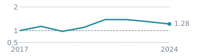 2017 = 0.77 |
| **E** | 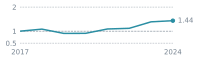 2017 = 51 |
| **E source** | `UMD_GHGIA_T_3_14.emissions` via `EPA_GHGI_NEU` (57%); `UMD_GHGIA_T_4_31` via `Direct` (36%); `UMD_GHGIA_T_3_11.ng_manufacturing` via `Hybrid_Facility_MECS` (6%) |
| **E explanation** | The rise is supported, but its timing isn't. `E` rises 31%, the same as facility-reported emissions (GHGRP, 21.5 to 28.1 Mt). Ethylene output rises 40%, so emissions per tonne fall about 6%. `E` jumps 20% in 2021 when facility emissions rise 5%. That jump comes from switching survey years for the non-energy share, not from real activity. |
| **q** | 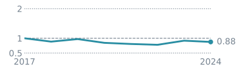 2017 = 63 |
| **q explanation** | Doesn't follow physical output. `q` falls 12% while ethylene rises 40%, though ethylene alone overstates growth because ethane cracking makes fewer co-products. Price isn't the reason over the whole period: BEA's price index and the producer price index both rise about 20%. BEA's index swings more from year to year, and that drives the yearly moves in `B`. |
| **A explanation** | Not yet assessed. Largest cells, gross percent of `N_d`: Oil and gas extraction bought by Petrochemical manufacturing (12.4); Petrochemical manufacturing bought by Petrochemical manufacturing (8.8); Electric power generation, transmission, and distribution bought by Petrochemical manufacturing (6.2) |
| **L explanation** | Not yet assessed. |
| **Conclusion** | **Split.** `B` ends 25% higher, with `E` up 31% and `q` down 12%. The rise in `E` is justified. The rise in `B` isn't, because it comes from `q` not following tonnes. Per tonne of ethylene the factor falls about 6%. Two things to fix: the 2021 step in the non-energy share, and the source of `q`. `L` is 34% of the movement, led by oil and gas inputs falling from 13.4 to 9.3 per $100 of output. |

### 531ORE Other real estate

| Field | Value |
|---|---|
| **B** | 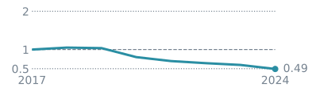 2017 = 0.045 |
| **E** | 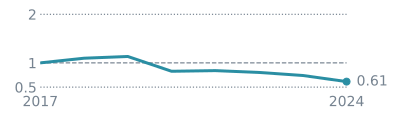 2017 = 58 |
| **E source** | `UMD_GHGIA_T_3_4.non_manufacturing_natural_gas` via `Nowcast_Detail_Use_AfterRedef` (94%); `UMD_GHGIA_T_3_4.petroleum_commercial` via `Nowcast_Detail_Use_AfterRedef` (5%); `UMD_GHGIA_T_4_60.refrigerants` via `Nowcast_Detail_Use_AfterRedef` (1%) |
| **E explanation** | Not yet assessed. |
| **q** | 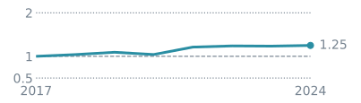 2017 = 1287 |
| **q explanation** | Not yet assessed. |
| **A explanation** | Not yet assessed. Largest cells, gross percent of `N_d`: Electric power generation, transmission, and distribution bought by Other real estate (19.7); Solid waste landfilling bought by Other real estate (4.4); Other real estate bought by Other real estate (3.7) |
| **L explanation** | Not yet assessed. |
| **Conclusion** | **Provisional, likely not justified.** `B` ends 51% lower, with `E` down 39% and `q` up 25%. `E` is 94% commercial natural gas, shared out using the Use table. Total commercial gas rises 5% (173 to 182 Mt), but this sector's share falls from 31% to 18%. At a constant share `E` would be about flat, so the fall comes from how the gas is shared out, not from measured gas. The sector's gas purchases rise only from $4.9bn to $5.6bn, while all industries' purchases double. `L` is 57% of the movement, led by electricity falling from 2.84 to 1.62 per $100 of output, and this column has no annual source. |

### 331110 Iron and steel mills and ferroalloy manufacturing

| Field | Value |
|---|---|
| **B** | 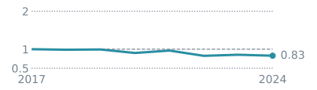 2017 = 0.74 |
| **E** | 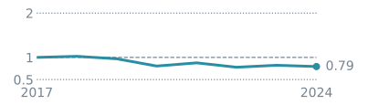 2017 = 77 |
| **E source** | `UMD_GHGIA_T_2_S1.direct` via `Direct` (69%); `UMD_GHGIA_T_3_11.ng_manufacturing` via `Hybrid_Facility_MECS` (19%); `UMD_GHGIA_T_3_14.emissions` via `EPA_GHGI_NEU` (10%) |
| **E explanation** | The fall is supported in total. Facility-reported emissions (GHGRP) fall 15% (66 to 56 Mt) and `E` falls 21%. Most of the extra fall is coking coal in non-energy use (10.4 to 5.0 Mt), a line that swings in the inventory. The parts differ from the facility data: direct emissions rise (43 to 48 Mt) as direct reduced iron grows, while allocated natural gas falls much faster (21 to 7 Mt) than facility combustion does. Check the boundary between them. The inventory's 2024 production data repeats 2023. |
| **q** | 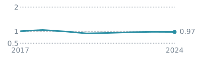 2017 = 102 |
| **q explanation** | About right. `q` falls 4%, against crude steel down 3% and the Federal Reserve production index up 4%. BEA's price index lags the producer price index in 2021-24 (1.25 against 1.52 of 2017 in 2024), so this price needs checking. |
| **A explanation** | Not yet assessed. Largest cells, gross percent of `N_d`: Electric power generation, transmission, and distribution bought by Iron and steel mills and ferroalloy manufacturing (10.9); Coal mining bought by Iron and steel mills and ferroalloy manufacturing (6.7); Iron and steel mills and ferroalloy manufacturing bought by Iron and steel mills and ferroalloy manufacturing (5.4) |
| **L explanation** | Not yet assessed. |
| **Conclusion** | **Mostly justified.** `B` ends 17% lower, with `E` down 21% and `q` down 4%. Using facility emissions and crude steel, it would end about 12% lower, so most of the fall is real. Facility combustion falls 20% while steel falls 3%, as electric arc furnaces grow from 68% to 71% of steel and pig iron falls 8%. The other 5 points or so are the coking coal line. `L` is 52% of the movement: electricity goes from 2.41 per $100 of output to 1.56 in 2021 and back to 2.31, and coal falls from 1.59 to 0.91. |

### 325190 Other basic organic chemical manufacturing

| Field | Value |
|---|---|
| **B** | 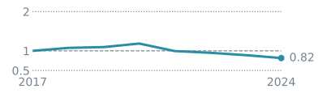 2017 = 0.63 |
| **E** | 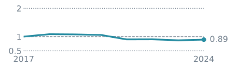 2017 = 75 |
| **E source** | `UMD_GHGIA_T_3_11.ng_manufacturing` via `Hybrid_Facility_MECS` (44%); `UMD_GHGIA_T_3_14.emissions` via `EPA_GHGI_NEU` (22%); `UMD_GHGIA_T_2_S1.direct` via `Direct` (13%) |
| **E explanation** | Only part is supported. N2O falls from 7.9 to 2.5 Mt, mostly from adipic acid, and that's real. The fossil part isn't: facility-reported emissions (GHGRP) rise 11% (52 to 58 Mt), while natural gas in `E` falls (32 to 30 Mt) and so does non-energy use (18 to 15 Mt). Both step down in 2021, when the survey year changes, while facility emissions rise. |
| **q** | 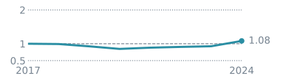 2017 = 117 |
| **q explanation** | `q` rises 8%, nearly all in 2024 (+17%), and that needs checking. The Federal Reserve production index for basic chemicals, a broader group, falls 6% and is flat in 2024. Price isn't the reason: BEA's price index and the producer price index both rise about 25%. |
| **A explanation** | Not yet assessed. Largest cells, gross percent of `N_d`: Petrochemical manufacturing bought by Other basic organic chemical manufacturing (12.3); Grain farming bought by Other basic organic chemical manufacturing (9.2); Electric power generation, transmission, and distribution bought by Other basic organic chemical manufacturing (5.7) |
| **L explanation** | Not yet assessed. |
| **Conclusion** | **Split.** `B` ends 19% lower. About 7 points are justified, from adipic acid N2O. The rest isn't: about 4 points are allocated fossil emissions falling in 2021 while facility emissions rise, and about 8 are the 2024 jump in `q`. Without those, `B` would end about 7% lower. `L` is 39% of the movement: petrochemical inputs (12.4 to 6.2 per $100 of output) and own use (6.5 to 3.0) both halve. |

### 325211 Plastics material and resin manufacturing

| Field | Value |
|---|---|
| **B** | 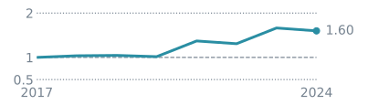 2017 = 0.4 |
| **E** | 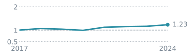 2017 = 31 |
| **E source** | `UMD_GHGIA_T_3_14.emissions` via `EPA_GHGI_NEU` (48%); `UMD_GHGIA_T_3_11.ng_manufacturing` via `Hybrid_Facility_MECS` (44%); `UMD_GHGIA_T_3_11.petroleum_facility` via `Hybrid_Facility_MECS` (2%) |
| **E explanation** | Partly supported. Facility-reported emissions (GHGRP) appear to fall (23.4 to 19.2 Mt), but only because adipic acid N2O at these facilities ends (6.0 to 0 Mt), which `E` counts in another sector. Without it they rise 10%. `E` rises more, 25%: natural gas up 19% (14.1 to 16.8 Mt) and non-energy use up 49% (13.8 to 20.6 Mt). Facility data can't check non-energy use, and its share steps up when the survey year changes. |
| **q** | 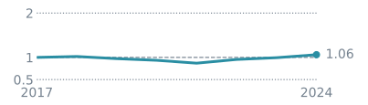 2017 = 89 |
| **q explanation** | Consistent with physical output. `q` rises 6%, against the Federal Reserve production index up 4%. BEA's price index and the producer price index both rise about 16-17%. |
| **A explanation** | Not yet assessed. Largest cells, gross percent of `N_d`: Petrochemical manufacturing bought by Plastics material and resin manufacturing (14.5); Other basic organic chemical manufacturing bought by Plastics material and resin manufacturing (10.4); Electric power generation, transmission, and distribution bought by Plastics material and resin manufacturing (5.1) |
| **L explanation** | Not yet assessed. |
| **Conclusion** | **Split.** `B` ends 16% higher, with `E` up 25% and `q` up 6%. Using facility emissions without adipic acid, it would end about 4% higher, so about a quarter of the rise is supported. The rest is mainly the rise in non-energy use, which no annual measure confirms. `L` is 41% of the movement and not yet assessed. |

## Earlier findings for sectors not on the current list

### 1111B0 Grain farming

**Earlier tracker row 3**

- **Driver:** Grain farming `1111B0` soils via `EPA_GHGI_soils`
- **Issue:** [#934](https://github.com/cornerstone-data/bedrock/issues/934)
- **Diagnostic:** D9 · D8
- **Effect:** The largest non-fuel rocky cell. Soils attribution moved 88.1 Mt and settled 9.5 Mt lower.
- **Potency:** 88.1 Mt gross; oscillation 0.89
- **Justified?:** **unresolved**
- **Status:** Filed as [#934](https://github.com/cornerstone-data/bedrock/issues/934)

### 483000 Water transportation

**Earlier tracker row 13**

- **Driver:** Water transportation `483000`
- **Issue:** [#936](https://github.com/cornerstone-data/bedrock/issues/936)
- **Diagnostic:** D6a
- **Effect:** The largest single bottom-up movement in the panel: +87.0% on the `N`-weighted metric in 2021, reversing −25.8% in 2022. Own-share 0.78 to 0.89, so it passes almost undamped to buyers.
- **Potency:** `delta_B_pct_of_N` +87.0% (2021)
- **Justified?:** **unresolved**
- **Status:** Filed as [#936](https://github.com/cornerstone-data/bedrock/issues/936). Check against the 2021 reversal in row 8 — may be the same fuel-price event

### 114000 Fishing, hunting and trapping

**Earlier tracker row 5**

- **Driver:** ~~Negative emission factors on `114000` and `327910`~~ — **a build-vintage artefact**
- **Issue:** [#912](https://github.com/cornerstone-data/bedrock/issues/912)
- **Diagnostic:** D6a · D7
- **Effect:** Does not reproduce on the published FBS `v0.3.0_99655e9`, where **no commodity is negative in any year**. The negatives came from `v0.3.0_796a6ca`, a local-only build off a branch no ref reaches, which the resolver picked because it ranked span-covering vintages on **file mtime**. The real defect was the resolver, now fixed to rank on provenance and to refuse to guess.
- **Potency:** none — the finding is withdrawn. `114000` is a genuine mover on the published build, second in the panel; `327910` is unremarkable at rank 655 of 2,835
- **Justified?:** **n/a — withdrawn**
- **Status:** **Resolved.** Close #912. Lesson recorded in `About_B_change_drivers.md` (removed; see git history)

### 327910 Abrasive product manufacturing

**Earlier tracker row 5**

- **Driver:** ~~Negative emission factors on `114000` and `327910`~~ — **a build-vintage artefact**
- **Issue:** [#912](https://github.com/cornerstone-data/bedrock/issues/912)
- **Diagnostic:** D6a · D7
- **Effect:** Does not reproduce on the published FBS `v0.3.0_99655e9`, where **no commodity is negative in any year**. The negatives came from `v0.3.0_796a6ca`, a local-only build off a branch no ref reaches, which the resolver picked because it ranked span-covering vintages on **file mtime**. The real defect was the resolver, now fixed to rank on provenance and to refuse to guess.
- **Potency:** none — the finding is withdrawn. `114000` is a genuine mover on the published build, second in the panel; `327910` is unremarkable at rank 655 of 2,835
- **Justified?:** **n/a — withdrawn**
- **Status:** **Resolved.** Close #912. Lesson recorded in `About_B_change_drivers.md` (removed; see git history)

## Earlier cross-sector findings

Findings from the earlier tracker that span many sectors, so they have no single
sector entry.

**Earlier tracker row 6**

- **Driver:** EPA attribution table renumbering
- **Issue:** —
- **Diagnostic:** D2b vs D2a
- **Effect:** Soils `T_5_17`→`T_5_18`→`T_5_19` and non-energy use `T_3_25b`→`T_3_25` mid-span, so `T_5_18` means *direct* in some years and *indirect* in others. 2019 booked −301 Mt against +255 Mt on flat emissions.
- **Potency:** ±300 Mt of pure artefact in 2019, ±85 Mt in 2023
- **Justified?:** **not justified**
- **Status:** **Fixed** in this PR via `ATTRIBUTION_ROLE_ALIAS`

**Earlier tracker row 7**

- **Driver:** Prices in a nominal denominator
- **Issue:** —
- **Diagnostic:** D5 · D6a
- **Effect:** `x` is nominal on the nowcast path. 74% of both the 2021 and 2022 E-versus-x gap is the deflator, and 56% of the span's nominal output growth.
- **Potency:** 24% price wedge over the span
- **Justified?:** **justified** — inflation is real, but must be controlled for
- **Status:** **Handled**: every divergence table has a `*_real` companion

**Earlier tracker row 9**

- **Driver:** COVID shock and rebound, 2020-21
- **Issue:** —
- **Diagnostic:** D6a · D3
- **Effect:** Every attribution class dips in 2020 and rebounds in 2021. Puts 13 of the bottom-up top 30 in 2021 alone.
- **Potency:** median `abs_delta_B_pct_of_N` 1.17% in 2021 against 0.32% in 2018
- **Justified?:** **justified** — a real event
- **Status:** **Do not smooth.** Argues for ranking within year as well as pooled

**Earlier tracker row 10**

- **Driver:** `L` / the `A` matrix
- **Issue:** [#937](https://github.com/cornerstone-data/bedrock/issues/937) · basis [#957](https://github.com/cornerstone-data/bedrock/issues/957)
- **Diagnostic:** D6b
- **Effect:** Moves `N` **1.1 to 3.0 times** as much as the emission factors do — 5.9 of the 8.1 percentage points of median `N` movement in 2021. ⚠️ **Restated 2026-09-21.** The original "two to four times", and the 14.8 of 18.4 points it rested on, were measured against a hybrid `N` — real `B`, nominal `L`. On one basis the 2021 `L` effect is 5.9 points, not 14.8, and **the worst year is 2020, not 2021**.
- **Potency:** median `pct_change_N_L_effect` 2.7% to 6.1% a year
- **Justified?:** **out of scope**
- **Status:** Handed over as [#937](https://github.com/cornerstone-data/bedrock/issues/937), on Nowcasting Phase 2. ➡️ **Now ranked per commodity — see row 18**, which turns this bound into a work list. ⚠️ **The price question is closed, not open**: a consistent deflation cancels out of `N` (`N_real = N_nominal / ρ`), so none of the residual 2.7-6.1% is a price term, and deflating `A` buys no stability — real gross \|d`L`\| is within 9% of nominal every year but 2024, where it is 64% *larger*. Evidence in [`About_the_L_dollar_basis.md`](../nowcasting/About_the_L_dollar_basis.md)

**Earlier tracker row 11**

- **Driver:** `Vnorm` / the nowcast Make
- **Issue:** [#938](https://github.com/cornerstone-data/bedrock/issues/938)
- **Diagnostic:** D3 · D13
- **Effect:** 3% to 6% of gross `B` movement through 2022, then 12.2% and 11.9%. Cumulative displacement flattens after 2022 at ~25 Mt while annual churn rises.
- **Potency:** output-weighted share of gross `B` movement, to 12.2%
- **Justified?:** **out of scope** for remediation
- **Status:** Handed over as [#938](https://github.com/cornerstone-data/bedrock/issues/938), on Nowcasting Phase 2. The 2023 step-up is unexplained

**Earlier tracker row 12**

- **Driver:** Use-table attribution tracks output, and the inventory-named half does not
- **Issue:** [#933](https://github.com/cornerstone-data/bedrock/issues/933)
- **Diagnostic:** D4 · D9 · D10
- **Effect:** Emissions spread by a row of `U` have an output elasticity of **1.02** against **0.54** for emissions the inventory names directly — so a Use-derived split moves one-for-one with the economy whether or not anything was emitted, while measured emissions move at half that rate. It rides a sector's fuel *purchases* while `x` is a row sum of `V`. Affects 30% of `E`. ⚠️ The pre-vintage-fix run put the slope at 1.51 and read it as *amplification*; at 1.02 the finding is the **gap to `Direct`**, not an overshoot.
- **Potency:** slope 1.02 against 0.54; 194 Mt of the rocky mass routes this way by label, ~409 Mt of table 3-11 in fact
- **Justified?:** **unresolved**
- **Status:** Structural, and **larger than the route labels show** — see row 15. Promoted from possible to likely common cause behind rows 1 and 2, and the reason [#933](https://github.com/cornerstone-data/bedrock/issues/933) outranks #918 for them

**Earlier tracker row 15**

- **Driver:** EPA table 3-11 fossil fuel combustion, as a family
- **Issue:** [#923](https://github.com/cornerstone-data/bedrock/issues/923) · [#918](https://github.com/cornerstone-data/bedrock/issues/918)
- **Diagnostic:** D9 · D8 · D2a
- **Effect:** The largest driver family in the panel and the umbrella over rows 1 and 2, which name its three biggest cells. 698 Mt of gross movement across 567 cells, netting −50 Mt, ⚠️ **The route labels mislead.** By label it is 504 Mt MECS and 194 Mt Use; by provenance 216 Mt of that MECS mass is `petroleum_industrial`, whose weights are BEA Use money rescaled by a MECS fuel share, so **~409 Mt of the 698 Mt — 59% — runs on the Use table** and only ~288 Mt on MECS quantities. The MECS vintage steps from the 2018 survey to the 2022 survey between nowcast 2020 and 2021, and 2021 carries 2.9x the sector reallocation of a within-vintage year against 1.6x on the non-MECS control.
- **Potency:** 698 Mt gross, 23.3% of all gross movement in the panel; ~9pp of 2021 reallocation above the control
- **Justified?:** **split** — the Use-table 59% is **not justified** via rows 1 and 2; the MECS 41% stays **unresolved**, its cutoff measured but its emissions not
- **Status:** ⚠️ Umbrella: do not sum its potency with rows 1 and 2. Both halves resolve the same way — [#929](https://github.com/cornerstone-data/bedrock/issues/929) replaces the Use-table part outright, and manufacturing combustion is **100%** inside the facility scope, so [#918](https://github.com/cornerstone-data/bedrock/issues/918), [#920](https://github.com/cornerstone-data/bedrock/issues/920) and [#921](https://github.com/cornerstone-data/bedrock/issues/921) all retire with it. Evidence in `About_B_change_drivers.md` (removed; see git history) §4 mechanism 5

**Earlier tracker row 17**

- **Driver:** Self-supplied fuel has no purchase to be allocated by
- **Issue:** [#923](https://github.com/cornerstone-data/bedrock/issues/923) · [#927](https://github.com/cornerstone-data/bedrock/issues/927)
- **Diagnostic:** D15
- **Effect:** Fuel that never changed hands — refinery still gas, coke oven gas and blast furnace gas, **and the lease and plant fuel an oil and gas operation burns out of its own stream** — never appears as a purchase, so **no row of the Use table can carry it**. Today it rides the same purchased-fuel vector as everything else, which is a category error rather than an inaccuracy. The byproduct-gas half was measured at 37.0 Mt in 2022, 22.4 Mt of it petroleum refineries; widening the class to every self-supplied fuel takes it to **144.9 Mt**, of which 83.8 Mt is oil and gas extraction (PR #961, a later run vintage).
- **Potency:** 144.9 Mt, 9.7% of facility-reported emissions; the direct cause of the sectors D14 puts in `boundary_offset`
- **Justified?:** **not justified** — the vector cannot represent the flow
- **Status:** The category now exists: `fuel_class` is `purchased` or `self_supplied`, with `fuel_class_basis` naming the evidence. ⚠️ Still a **floor** for byproduct gas, which GHGRP does not label and which is imputed from matched NEI records — 46.9 Mt of the 144.9 — and **only from 2021** (row 19 / [#926](https://github.com/cornerstone-data/bedrock/issues/926)). The lease and plant fuel half is not imputed: subpart W has the reporter name the fuel, and that half spans 2017-2024

**Earlier tracker row 18**

- **Driver:** **Which commodities' `L` actually destabilises `N`** — the ranked work list behind row 10
- **Issue:** [#896](https://github.com/cornerstone-data/bedrock/issues/896) · [#922](https://github.com/cornerstone-data/bedrock/issues/922)
- **Diagnostic:** D6b, ranked per commodity rather than at the median
- **Effect:** Row 10 gives a bound; this gives the list. Ranking every commodity on output-weighted gross `L` effect and splitting on oscillation separates churn from trend. ⚠️ **The electricity row `221100` is a driving `A` cell for ALL 20 top-ranked commodities and carries 30.9% of their top-cell contribution mass** — reaching [#896](https://github.com/cornerstone-data/bedrock/issues/896) from `N` stability rather than from the electricity method. Worst case `441000` motor vehicle dealers: oscillation 0.97, `L` moves its `N` **4.8x** its own factors, own electricity coefficient +60% from its 2019 trough to 2022 then −43% by 2024. Second convergence: `324110` refineries' churn is the oil and gas → refineries coefficient, i.e. rows 1, 2 and 16.
- **Potency:** gross 109.1 at oscillation 0.97 (`441000`), down to 38.9 at 0.98 (`324110`); trend group oscillates at 0.00-0.21
- **Justified?:** **split** — the churn group is **unresolved but pointed**, the trend group (`531HSO`, `550000`, `541511`, `541100`, `511200`, `541512`, oscillation 0.00-0.21, all monotone) looks **justified** and must not be smoothed
- **Status:** ⚠️ **Order: settle [#896](https://github.com/cornerstone-data/bedrock/issues/896) first, then [#922](https://github.com/cornerstone-data/bedrock/issues/922)/[#923](https://github.com/cornerstone-data/bedrock/issues/923), then re-run.** Six of the eight churners carry an electricity share, so their movement may go with #896; and several of the *trend* commodities do too (`541511` is 36.3% electricity at oscillation 0.06), so even the leave-alone verdicts need re-reading after. Evidence and full tables in [`About_the_L_flux_priority.md`](../nowcasting/About_the_L_flux_priority.md)

**Earlier tracker row 19**

- **Driver:** NEI SCC reclassification, 2020/2021
- **Issue:** [#926](https://github.com/cornerstone-data/bedrock/issues/926)
- **Diagnostic:** D15 · `nei_scc_reclassification` · `nei_combustion_process_backcast`
- **Effect:** NEI on-site CO2 (SCC branches 1-3) is flat across 2020→2021 (2,333 → 2,427 Mt), but the share on combustion SCCs jumps **2.9% → 75.5%**. Ungated SCC `fuel_class` collapses into `process` before 2021 and into `purchased` after. A related facility-count step lands a year earlier (2019→2020: 12,030 → 19,989 NEI CO2 facilities; D15 union 12,827 → 15,743).
- **Potency:** discontinuous NEI `fuel_class`; continuous union totals on SCC 1-3
- **Justified?:** **not justified** — a coding change, not an emissions move
- **Status:** **Handled for `fuel_class`.** `NEI_FUEL_CLASS_FIRST_YEAR = 2021` in `facility_combustion`: NEI-derived and NEI-share-imputed `fuel_class` only from 2021; earlier NEI rows stay in the union as `unclassified`. GHGRP subpart W `fuel_class` is unchanged. §5 share churn is not distorted — low on both sides of both seams. **Combustion vs process time series:** `nei_combustion_process_backcast` is part of every `B_change_diagnostics.main` run and restates the pre-2021 SCC coding split from 2021/2022 FacilityID twins without changing levels or `fuel_class`. Inventing pre-2021 `fuel_class` from that split remains open (needs a second twin rule for `self_supplied`). ⚠️ The CO2 series still ends at 2022 (`NEI_LAST_YEAR`); EPA omitted CO2 from NEI 2023 ([#932](https://github.com/cornerstone-data/bedrock/issues/932) / [#970](https://github.com/cornerstone-data/bedrock/issues/970)). Evidence in [`About_facility_emissions_basis.md`](../ghg_model/About_facility_emissions_basis.md) §5 / §7

## Reference moved from the tracker

The notes that used to surround the tracker table, unchanged.

Phase 1 closed on 2026-10-02. Rows 1, 2, 15, 16 and 17 were waiting on the
facility basis (#929), which is now in the v0.5 GHG FBS; their result is
measured in
`About_B_smoothing_phase1_outcome.md` (removed; see git history).
Open rows carry over to Phase 2 through their issues. The figures below are
from the 2026-09-21 run and were not restated.

A running list of the departures the diagnostics surface, what each one is
worth, and whether it turns out to be justified. This is the working document
for the plan's "determine why the drivers change and how to fix them" step.

Measurements come from `B_change_diagnostics.py`; the standing results are in
`About_B_change_drivers.md` (removed; see git history). Figures quoted here
are the run of 2026-09-21 on FBS `v0.3.0_99655e9` and MUT `v0.3.0_4276083`.
⚠️ Every `N`-derived figure was restated on 2026-09-21 when `N_total` stopped
mixing a real `B` with a nominal `L` ([#957](https://github.com/cornerstone-data/bedrock/issues/957));
`B`-only potencies and every Mt figure are untouched.
⚠️ Every figure was restated on 2026-09-18: the prior run resolved to a
local-only FBS build that no ref reaches. See the vintage section of
`About_B_change_drivers.md` (removed; see git history).

### How to use it

#### Start from IV / assessment (sector deep-dive)

For a commodity-year move in D or N, open from the **IV score** (or an
assessment flag), not from this tracker's quoted Mt figures:

1. Rank / peak year from `IV_score` outputs (pins in that run's log /
   `vintages.txt`) — see [`IV_score.py`](IV_score.py) and `About_IV_score.md`
   when that note is on the branch.
2. Rebuild dig (+ assessment levels) at those FBS/MUT pins; filter
   `B_change_real.csv` for the code and peak year.
3. **Triage (D6):** large `%ΔB` / `abs_delta_B_pct_of_N` → direct path; L
   effect dominates `pct_change_N_*` → structure path (`nd_drivers`).
4. Follow the matching D# path; record **Justified?** with the same vocabulary
   as the table below.

Checklist: [`About_sector_deep_dive.md`](About_sector_deep_dive.md). D#
register: `B_matrix_smoothing_plan.md` (removed; see git history).

⚠️ Tracker rows and figures in
`About_B_change_drivers.md` (removed; see git history) may predate the
current IV pins — use them as a map of which D# to open, not as live evidence.

**Justified?** is the field that takes real work. It cannot be answered from
the diagnostics — they say *that* something departed and by how much, never
whether it should have. Answering it means going back to the source and the
assumptions behind it. Until that is done the verdict is `unresolved`, and an
`unresolved` driver is not a candidate for smoothing.

| verdict | meaning |
|---|---|
| **justified** | a real movement in the world. Do not smooth; a smoothing change here would destroy signal. |
| **not justified** | movement with nothing underneath it. A defect, in scope, fix it. |
| **out of scope** | real driver, but this project has no lever on it. Hand over with the evidence. |
| **unresolved** | not yet investigated. Needs the source-level work before it can be ranked. |
| **split** | only for an umbrella row whose parts landed differently. State the share each way, or the row says nothing. |

**Diagnostic** is the output that pointed us at the row, and the one to open to
confirm it or to re-check it after a fix. The key beneath the tracker says what
to open for each `D#`; the full register — the question each asks, the method,
every file it writes — is in
`B_matrix_smoothing_plan.md` (removed; see git history).
Cite the diagnostic that *surfaced* the driver, not every table the row could
be checked against. A row with no diagnostic behind it came from somewhere else
— a code or source review — and says so; that is allowed, but it means the
diagnostics cannot yet see the driver, which is itself worth recording.

**Issue** is empty only where nothing is owed. Rows 6 and 7 were resolved in
the change that created this tracker; rows 8 and 9 are `justified` verdicts,
and a justified driver needs no issue because the correct action is to leave
it alone. ⚠️ An `unresolved` row with no issue is a gap — every one of them
now has an issue, and a new row should get one before the verdict is written.

**Potency** is whichever measure fits the driver. Top-down drivers are in Mt
CO2e of gross divergence over the span; bottom-up ones in `delta_B_pct_of_N`.
They are not comparable across rows and should not be summed — read potency
within a class of driver, not across.

⚠️ **Oscillation is the single most useful screen.** A large driver that
oscillates near 1 moves a great deal and arrives where it started, which is the
signature of movement with nothing underneath it. A large driver that
oscillates near 0 is on a trend and is usually real. Neither is proof, but it
is the right place to start an investigation.

#### Key to the Diagnostic column

What to open to confirm a row, and what to re-run after a fix. One line each;
the full definitions — the question, the method and every file — are in the
register in
`B_matrix_smoothing_plan.md` (removed; see git history).

| ID | Open | To see |
|---|---|---|
| **D2a** | `divergence_by_attribution_real.csv`, `divergence_by_metasource_real.csv` | which source moved CO2e away from output, keyed on the attribution *role* |
| **D2b** | `divergence_by_attribution_raw.csv` | the same keyed on EPA's raw table numbers. A split here that D2a does not show is a relabelling, not a movement |
| **D3** | `E_vs_x_indexed.png` | E by attribution class against x, indexed, with the Make's cumulative reallocation on the right axis |
| **D4** | `output_elasticity_real.csv` | whether a source tracked output (slope 1), ignored it (0) or amplified it (>1) |
| **D5** | `price_effect.csv` | how much of the year's E-versus-x gap is the deflator rather than emissions |
| **D6a** | `B_change_real.csv`, sorted on `abs_delta_B_pct_of_N` | which commodity factors moved most, weighted by the share of their own `N` they drive. **Also the acceptance measure** |
| **D6b** | `B_change_real.csv`, `pct_change_N_L_held` / `pct_change_N_L_effect` | how much of a commodity's `N` move is its factors and how much is `L` |
| **D7** | `B_by_attribution.csv` | which attribution route builds one commodity's factor, and what each contributes |
| **D8** | `divergence_by_sector_stratum.csv` | one (sector × source) cell year by year — the level behind a span figure |
| **D9** | `sector_stratum_span.csv`, `sector_stratum_divergence.png` | gross movement and `oscillation` per cell: the rocky-cell ranking rows 1-4 and 8 come from |
| **D10** | `io_derived_share.csv` | how much of `E` has its sector split derived from the IO tables at all |
| **D13** | ⚠️ nothing yet | the Make's share of gross `B` movement, year on year. Row 11's potency is quoted from an ad-hoc calculation; it cannot be re-run until the function exists |

⚠️ **After a fix, run the module whole and read D6a as well as the row's own
diagnostic.** It writes every table in one pass, so there is no cost to
re-reading the cited ID; what a single-row re-check cannot see is movement
displaced onto other commodities, which only the acceptance measures in
`B_matrix_smoothing_plan.md` (removed; see git history) will show. D1 runs on
every invocation and raises if the decomposition stops closing — a fix that
breaks it invalidates every other number in this file.

### What the rocky mass routes through

From D9, `sector_stratum_span.csv`. Of the 59 cells carrying more than 10 Mt
of gross movement, 28 oscillate above 0.75. Grouped by the vector that spread
them:

| attribution route | rocky mass | cells |
|---|---:|---:|
| `Direct` | 302 Mt | 8 |
| `Nowcast_Detail_Use_AfterRedef` | 192 Mt | 7 |
| `EPA_GHGI_soils` | 164 Mt | 6 |
| `Energy_manufacturing_national_nowcast` | 141 Mt | 5 |
| `EPA_GHGI_NEU` | 60 Mt | 2 |

Three of the five routes are attribution vectors rather than inventory rows,
and together they carry 497 Mt against `Direct`'s 302 Mt, which is why row 12
is on the list as a candidate common cause rather than as one more individual
cell.

⚠️ `Direct` appearing here is not a contradiction of row 8. Electric power is
not in this group — its oscillation is 0.42. The 302 Mt is eight *other*
`Direct` cells, led by air transportation and coal mining.

### Closing a row

A row leaves `unresolved` only with a stated reason and a source-level check
behind it, not on plausibility. Record the check in
`About_B_change_drivers.md` (removed; see git history) and link it here, and
add the diagnostic that carried the check to the row's **Diagnostic** cell —
the ID that *closed* a row is usually not the one that opened it. When
a driver is fixed, re-run the diagnostics and record the before-and-after on
the two acceptance measures in the plan — median `abs_delta_B_pct_of_N` and the
share over the gate — so an improvement bought by displacing movement onto
other commodities is visible rather than netted away.
